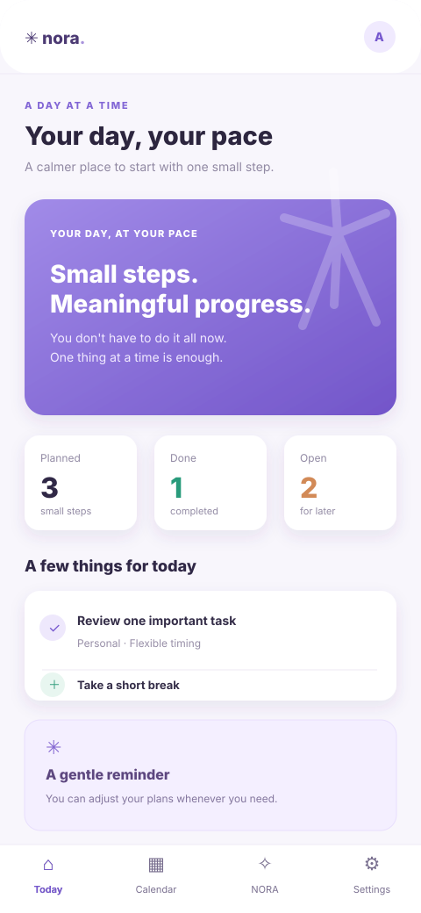

# ✳ NORA

### A gentler digital companion for everyday life

**Mental well-being · Neurodiversity · Sleep · Accessibility · Everyday routines**

**A collaborative project by the NORA founding team**

NORA is a project exploring calmer, more accessible ways to approach everyday tasks and routines. Its long-term product direction is informed by the experiences of people living with depression, anxiety, ADHD, OCD, insomnia and many other challenges — as well as anyone who benefits from flexible, supportive tools.

This repository is a **small, self-contained public demonstration**, not the complete NORA application. It is shared so people can explore a limited example, review the code, run the tests and contribute to this public slice.

<p align="center">
  
</p>

<p align="center">
  
  
</p>

<sub>These are illustrative vector concepts, not screenshots of a released application or evidence that the pictured features are implemented. The public demo below is substantially smaller.</sub>

---

## Why NORA exists

Everyday tasks can require more energy, attention or planning than they appear to from the outside. A disrupted routine, a long to-do list or an overwhelming day can make it difficult to decide where to begin.

NORA's guiding idea is to make everyday digital support more adaptable and less judgmental: small steps instead of pressure, flexible routines instead of rigid streaks, clear interactions instead of unnecessary complexity, and user choice instead of hidden automation.

The project is intended to be shaped responsibly around different needs. It is **not** a medical device, therapist, diagnostic system or emergency service. The current public demo does not implement condition-specific mental-health or sleep support and has not been clinically evaluated.

## What is included in this repository

This public repository contains only the reduced demonstration and materials needed to explore it:

- **Daily task list:** create, view, complete and remove tasks.
- **Simple organization:** assign a category and due date to each task.
- **Daily overview:** see the number of tasks and completed items for the current day.
- **Focus timer:** start, pause, continue and reset a simple focus session.
- **Local persistence:** save demo tasks in a local SQLite database.
- **Automated tests:** exercise the demo API and its validation using a temporary test database.
- **Continuous integration:** run the test suite on pushes and pull requests.

### What is not included

The complete private NORA application is not part of this repository. This public demo does not include the private product source code, account system, production infrastructure, private integrations, AI assistant services, full mobile application, remote synchronization or real user data.

The public demo is intentionally narrow. It should not be used as evidence that every planned NORA capability is implemented or production-ready.

## Explore the documentation

- [Care, inclusion and responsible support](docs/CARE-AND-INCLUSION.md)
- [Public demo feature map](docs/FEATURES.md)
- [Public demo architecture](docs/ARCHITECTURE.md)
- [Quality, validation and limitations](docs/QUALITY-AND-LIMITATIONS.md)
- [What is and is not open source](docs/OPEN-SOURCE-SCOPE.md)
- [Development history of this public repository](docs/DEVELOPMENT-HISTORY.md)
- [Publication safety checklist](docs/PUBLICATION-CHECKLIST.md)
- [Contributing guide](CONTRIBUTING.md)
- [Security policy](SECURITY.md)

## Run the public demo

The demo is designed for local evaluation with fictitious sample data. Python 3.10 or newer is recommended.

### Windows

1. Clone or download this repository.
2. Run `INICIAR_DEMO_WINDOWS.bat`.
3. Open [http://127.0.0.1:8000](http://127.0.0.1:8000).

### From a terminal

Create and activate a virtual environment, then run:

```bash
python -m venv .venv
# Windows PowerShell:
.venv\Scripts\Activate.ps1
# macOS / Linux:
# source .venv/bin/activate

python -m pip install -r requirements-dev.txt
python -m uvicorn demo.main:app --host 127.0.0.1 --port 8000
```

Open [http://127.0.0.1:8000](http://127.0.0.1:8000). The interactive API documentation is available at [http://127.0.0.1:8000/docs](http://127.0.0.1:8000/docs).

## Run the tests

```bash
python -m pip install -r requirements-dev.txt
python -m pytest -q tests
```

The tests use a temporary database. The GitHub Actions workflow also runs the test suite on pushes and pull requests.

## Safety and privacy

**This demo has no authentication and is for local evaluation only.**

- Keep it bound to `127.0.0.1`; do not expose it to the public internet or a shared network.
- Use only the fictitious sample information. Do not enter real names, health details, medication information, account credentials or other personal data.
- Do not add API keys, tokens, certificates, databases, backups, private logs or private application files to this repository.
- The demo does not provide mental-health care, medical advice, crisis response, diagnosis or treatment.

See [SECURITY.md](SECURITY.md) and the [publication safety checklist](docs/PUBLICATION-CHECKLIST.md).

## Technology used in this demo

| Area | Technology |
|---|---|
| Backend | Python, FastAPI, Pydantic |
| Frontend | JavaScript, HTML, CSS |
| Local data | SQLite |
| Tests | Pytest, HTTPX |
| CI | GitHub Actions |

## Contributing

Contributions to the public demo, its tests and its documentation are welcome. Please read [CONTRIBUTING.md](CONTRIBUTING.md) before opening an issue or pull request. Keep changes within the public scope and never add code or materials from the private NORA application.

## License and project boundaries

The files included in this public repository are released under the [MIT License](LICENSE). The license applies **only to the materials actually present in this repository**.

It does not grant rights to the separate private NORA application, code, services, integrations, data, credentials or assets that are not included here. The NORA name, logo and other brand identifiers are not granted as trademarks by this license. See [the open-source scope document](docs/OPEN-SOURCE-SCOPE.md).

---

**NORA founding team**  
[GitHub profile](https://github.com/ArthurGuimaraess) · [NORA public repository](https://github.com/ArthurGuimaraess/nora-personal-assistant)
