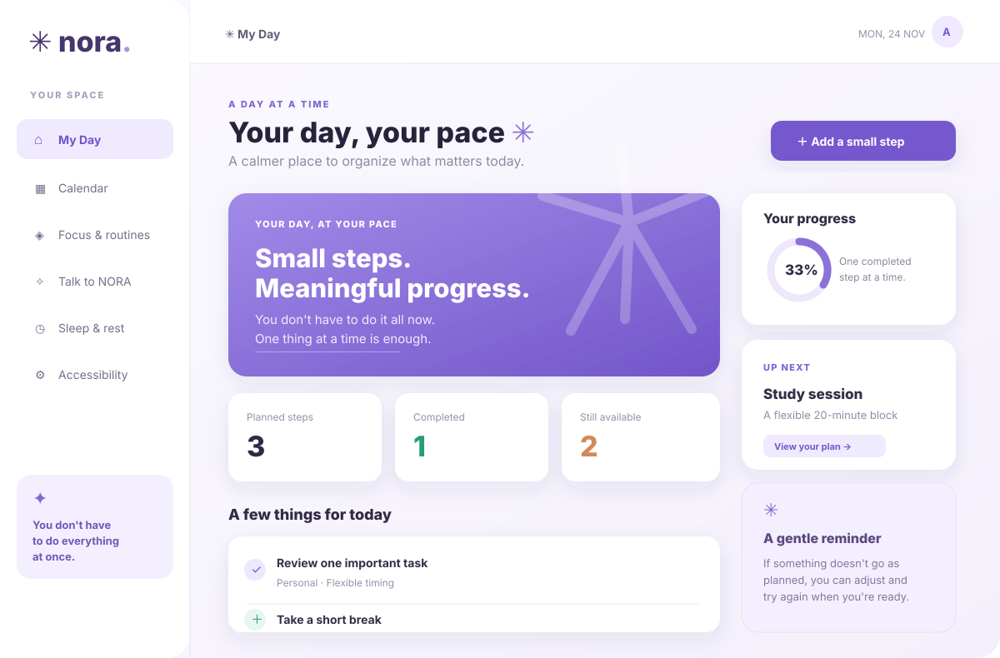
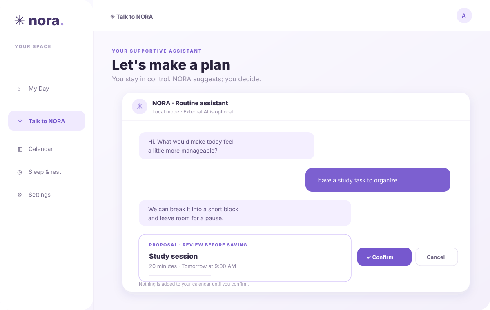

# ✳ NORA

### A gentler digital companion for everyday life

**Mental well-being · Neurodiversity · Sleep · Accessibility · Everyday routines**

**A collaborative project by the NORA founding team**

NORA explores how digital tools can make everyday routines, focus, rest and personal organization feel more accessible, flexible and less judgmental.

The product direction is informed by the experiences of people living with depression, anxiety, ADHD, OCD, insomnia and many other mental-health, neurodevelopmental, sleep or routine-related challenges — as well as anyone who benefits from a calmer, more adaptable way to approach daily life.

> **Important:** This repository contains a limited, local-only demonstration of selected NORA concepts. It is not the complete NORA application, does not provide condition-specific support or clinical functionality, and must not be treated as a medical or emergency service.

  

  
  

Illustrative vector concepts only — not live screenshots, production screens or proof that the pictured features are implemented.

---

## Contents

- [Why NORA exists](#why-nora-exists)
- [Product principles](#product-principles)
- [Who the product direction considers](#who-the-product-direction-considers)
- [What this repository actually contains](#what-this-repository-actually-contains)
- [How the public demo works](#how-the-public-demo-works)
- [API reference](#api-reference)
- [Run it locally](#run-it-locally)
- [Test and quality checks](#test-and-quality-checks)
- [Privacy, safety and limitations](#privacy-safety-and-limitations)
- [Project direction](#project-direction)
- [Contributing and open-source scope](#contributing-and-open-source-scope)

## Why NORA exists

Many digital tools assume that everyone has the same amount of energy, attention, time and ability to plan. Real life is not that consistent. A routine can be interrupted, a task can feel too large to start, a long list can increase overwhelm, and a plan that worked yesterday may not fit today.

NORA's guiding idea is to make everyday digital support more adaptable to the person rather than forcing the person to adapt to the tool.

The project's broader ambition is to bring everyday organization, flexible routines, focus, rest, accessibility and optional supportive interaction into a calmer experience. The public demo is intentionally much smaller: it lets reviewers inspect a concrete example of the project's engineering approach without exposing the complete private application.

## Product principles

### 1. Support without shame

An unfinished task is information, not a personal failure. Product language should avoid guilt, punitive streaks, pressure and productivity scores that treat rest or a difficult day as failure.

### 2. Flexible steps instead of rigid plans

A useful routine should be adjustable. The product direction favors manageable next steps, flexible focus sessions and the ability to change plans as energy or circumstances change.

### 3. Accessibility and choice

Clear navigation, readable layouts, keyboard access, adjustable presentation and reduced-stimulation options are important design considerations. People should not be forced into a single interaction style.

### 4. User agency and transparent automation

Suggestions should remain understandable and optional. AI-assisted actions, where available in future or separate product versions, should not silently change a person's plans. The person should understand what information is used and retain control over actions.

### 5. Privacy by design

Sensitive information should not be shared automatically. Public examples use fictitious data, and the public repository must not contain credentials, private application files, user records or private infrastructure configuration.

These principles describe the product's direction. They do not claim that every principle is fully implemented in the public demo.

## Who the product direction considers

NORA's broader design work considers different everyday challenges, including:

| Experience or need | Design consideration |
|---|---|
| Depression and low energy | Gentle language, manageable steps and no pressure to maintain a perfect routine |
| Anxiety and overwhelm | Predictable flows, clear choices and avoiding unnecessary alerts |
| ADHD and executive-function needs | Low-friction task capture, visible priorities and flexible focus sessions |
| OCD | Avoiding repeated checking, ritual reinforcement, compulsive logging and endless reassurance loops |
| Insomnia and sleep difficulties | User-chosen wind-down routines and organization tools, without claiming to treat sleep disorders |
| Sensory, cognitive or routine differences | Adjustable presentation and interaction rather than assuming one interface fits everyone |

These are design considerations, not clinical claims. The public demo does not implement mental-health-specific interventions, therapy, diagnosis, crisis support or insomnia treatment. NORA has not been clinically validated.

## What this repository actually contains

This repository is a **small public software sample**, not the complete NORA product.

### Included functionality

- **Daily task list:** view tasks scheduled for today.
- **Task creation:** add a task with a title, category and due date.
- **Task status:** mark a task complete or pending.
- **Task removal:** delete a task from the local demo database.
- **Daily overview:** view today's total, completed and pending task counts.
- **Focus timer:** a simple 25-minute browser timer that can be started, paused, continued and reset.
- **Local persistence:** store demo tasks in SQLite on the computer running the demo.
- **API documentation:** inspect the local FastAPI documentation at the /docs route.
- **Automated tests:** verify page availability, sample data, task operations, validation and persistence.
- **Continuous integration:** run the test suite through GitHub Actions on pushes and pull requests.

### Not included

The complete private NORA application is not part of this repository. The public demo does not include the full account system, production infrastructure, private services, remote synchronization, full mobile application, private AI integrations, real user records or condition-specific functionality.

The screenshots shown above are illustrative vector concepts. They do not represent a production release or the actual full application's current state.

## How the public demo works

The public sample uses a deliberately simple client-server structure:

| Layer | Implementation |
|---|---|
| Browser interface | HTML, CSS and vanilla JavaScript |
| API server | Python and FastAPI |
| Input validation | Pydantic models and server-side validation |
| Local database | SQLite |
| API exploration | FastAPI-generated interactive documentation |
| Automated testing | Pytest and FastAPI TestClient |
| Continuous integration | GitHub Actions |

### Request lifecycle

1. The browser loads the local HTML interface.
2. JavaScript requests tasks and the daily overview from the FastAPI server.
3. FastAPI validates incoming task data.
4. Parameterized SQLite statements create, read, update or delete task records.
5. The interface refreshes the visible task list and summary.

### Demo data

On first startup, the demo inserts three fictitious example tasks if the local task table is empty. The default database path is under the ignored instance/ directory. The NORA_DEMO_DB environment variable can be used to select another local database path.

The demo uses the America/Sao_Paulo time zone for its date and timestamp calculations.

## API reference

All endpoints below belong to the local demo. There is no authentication or multi-user authorization. Keep the server bound to 127.0.0.1.

| Method | Route | Purpose |
|---|---|---|
| GET | /api/status | Returns the demo name, mode and time zone |
| GET | /api/tasks | Lists saved demo tasks |
| GET | /api/overview | Returns today's total, completed and pending task counts |
| POST | /api/tasks | Creates a task |
| PATCH | /api/tasks/{task_id} | Changes whether a task is complete |
| DELETE | /api/tasks/{task_id} | Deletes a task |

### Create a task

The create endpoint accepts a title from 1 to 120 characters, a category and a due date in YYYY-MM-DD format. Supported categories are pessoal, estudos and rotina.

Example request:

~~~json
{
  "title": "Separar o material de estudo",
  "category": "estudos",
  "due_date": "2026-11-25"
}
~~~

### Mark a task as complete

~~~json
{
  "done": true
}
~~~

The API returns HTTP 201 when a task is created and HTTP 204 when a task is successfully deleted. Invalid input is rejected with a validation response; an unknown task ID returns HTTP 404 for update or delete operations.

Interactive API documentation is served locally at http://127.0.0.1:8000/docs after the demo starts.

## Run it locally

**Requirements:** Python 3.10 or newer is recommended.

### Windows

1. Clone or download this repository.
2. Run INICIAR_DEMO_WINDOWS.bat.
3. Open http://127.0.0.1:8000 in your browser.

### Manual setup

Create a virtual environment and install the development dependencies:

~~~bash
python -m venv .venv

# Windows PowerShell
.venv\Scripts\Activate.ps1

# macOS / Linux
# source .venv/bin/activate

python -m pip install -r requirements-dev.txt
python -m uvicorn demo.main:app --host 127.0.0.1 --port 8000
~~~

Then open:

- Demo: http://127.0.0.1:8000
- Interactive API docs: http://127.0.0.1:8000/docs

To stop the server, press Ctrl+C in the terminal.

## Test and quality checks

Run the test suite with:

~~~bash
python -m pip install -r requirements-dev.txt
python -m pytest -q tests
~~~

The tests use a temporary SQLite database so that test operations do not alter a developer's normal demo data.

The GitHub Actions workflow uses Python 3.12, installs requirements-dev.txt and runs the public demo tests on pushes and pull requests.

A passing test suite confirms only the behaviors covered by those tests. It is not an independent security audit, accessibility certification, privacy audit or clinical validation.

## Privacy, safety and limitations

**The public demo has no authentication and is intended for local evaluation only.**

- Keep the server bound to 127.0.0.1; do not expose it to the public internet or a shared network.
- Use only fictitious sample content. Do not enter real names, account details, health information, medication data or other personal information.
- Do not add API keys, access tokens, certificates, private configuration, databases, backups, user exports or private logs to this repository.
- The demo does not call external AI or search providers.
- The demo does not provide diagnosis, treatment, psychotherapy, medication recommendations, continuous monitoring or emergency/crisis response.
- The product direction has not been clinically validated.
- Do not assume that the illustrative images show implemented features.

For a security concern, see SECURITY.md. For public contribution boundaries, see CONTRIBUTING.md.

## Project direction

The broader NORA project aims to explore:

- More flexible personal routines and everyday planning.
- Accessible and adjustable interaction patterns.
- Supportive language and low-pressure task organization.
- Focus and rest-related experiences that respect user choice.
- Transparent, optional AI assistance with explicit user control.
- Privacy-conscious handling of sensitive information.

These are product directions, not a release roadmap or a claim that these features are included in this public repository. The public demo remains a narrow local example while the larger product continues to evolve separately.

## Contributing and open-source scope

Contributions to the public demo, tests and documentation are welcome. Please read CONTRIBUTING.md before opening an issue or pull request.

The materials in this repository are released under the MIT License (LICENSE). That license applies **only to the files actually included in this public repository**.

It does not grant rights to the separate private NORA application, source code, services, integrations, data, credentials, assets or infrastructure that are not included here. It also does not grant trademark rights to the NORA name or logo. Read docs/OPEN-SOURCE-SCOPE.md for the exact boundary.

---

**A collaborative project by the NORA founding team**  
[Public repository](https://github.com/ArthurGuimaraess/nora-personal-assistant) · [Project maintainer profile](https://github.com/ArthurGuimaraess)
